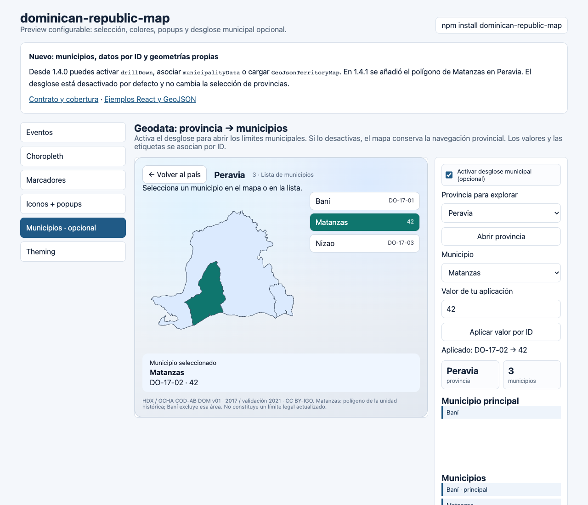

# dominican-republic-map

[](https://github.com/uppy19d0/library-dominican-republic-map/actions/workflows/ci.yml)
[](./LICENSE)
[](https://www.npmjs.com/package/dominican-republic-map)

Language: English | [Espanol](./README.es.md)

Interactive, touch-friendly SVG map of the **Dominican Republic**. It includes all 32 provinces, selection, choropleth colors, markers, wheel and pinch zoom, pan, tooltips, keyboard support, popups, and production-ready styles.

Created by [Luis Aneuris Tavarez De Jesus](https://www.ltavarez.me/).

## Screenshot

[](https://raw.githack.com/uppy19d0/library-dominican-republic-map/gh-pages/docs/demo/index.html)

## Interactive Preview

GitHub and npm READMEs cannot run embedded JavaScript, so the screenshot opens an external interactive preview with events, choropleth data, custom colors, markers, icons, and popups.

[Open interactive preview](https://raw.githack.com/uppy19d0/library-dominican-republic-map/gh-pages/docs/demo/index.html) · [GitHub Pages URL](https://uppy19d0.github.io/library-dominican-republic-map/docs/demo/) · [View demo source](./docs/demo/index.html)

## New optional map modes

Province navigation remains the default. Enable municipal drill-down with `drillDown={true}` in React or `map.mapProps = { drillDown: true }` in the Web Component. Add `municipalityData` for values by municipality ID, or use the separate `GeoJsonTerritoryMap` for application-owned boundaries. Matanzas in Peravia is included from 1.4.1. The Interactive Preview now includes an opt-in switch, value editor and the configuration for the selected mode; its runtime assets are built from the lockfile and hosted with the demo.

```jsx
// Default: provinces
<DominicanRepublicMap />
// Optional: municipal boundaries and values
<DominicanRepublicMap drillDown municipalityData={{ 'DO-17-02': { value: 42 } }} />
```

See [parameters, events and coverage](docs/municipality-drilldown.md) and [custom GeoJSON](docs/custom-territories.md).

## Features

- 32 Dominican Republic provinces with embedded SVG paths
- Mouse, touch, and keyboard interactions
- Single, multiple, controlled, and uncontrolled selection
- Choropleth colors from numeric province data
- Global colors, per-province colors, and per-state colors
- Built-in marker icons: pin, car, pickup, truck, people, building, hospital, school, shield, warning
- Native click/tap popups for provinces and markers
- Native tooltips or custom renderers
- Optional province abbreviation labels
- Accessible province buttons with `aria-*`, Enter, and Space support
- Full TypeScript types
- CSS variables for theming
- React API plus Web Component API for Vue, Svelte, Angular, and vanilla JavaScript
- Geodata helpers for municipalities and main municipality/city via `dominican-republic-map/geodata`

## Production Readiness

- CI validates TypeScript, tests, SSR rendering, build output, and npm package contents.
- Releases are published from version tags with npm provenance support.
- Public security, contribution, and code of conduct policies are included in the repository and npm package.
- Runtime is framework-friendly: React consumers use the typed component, while other frameworks can use the custom element.

## Installation

React:

```bash
npm install dominican-republic-map
```

Vue, Svelte, Angular, or vanilla JavaScript:

```bash
npm install react react-dom dominican-republic-map
```

`react` and `react-dom` are peer dependencies because the Web Component uses React internally.

## Framework Support

| Project | Use | Best for |
| --- | --- | --- |
| React | `DominicanRepublicMap` | Typed props, custom renderers, React callbacks |
| Vue | `<dr-map>` | Templates, DOM events, complex props through `mapProps` |
| Svelte | `<dr-map>` | JSON attributes, DOM events, simple integration |
| Angular | `<dr-map>` | Custom Elements with `CUSTOM_ELEMENTS_SCHEMA` |
| HTML / Vanilla JS | `<dr-map>` | Static demos, dashboards, CMS pages |

Useful links:

- [Getting started](./docs/getting-started.md)
- [Framework guides](./docs/frameworks/README.md)
- [API reference](./docs/api.md)
- [API recipes](./docs/recipes.md)
- [Theming](./docs/theming.md)
- [Touch and zoom](./docs/gestures.md)
- [Interactive demo source](./docs/demo/index.html)
- [Release automation](./docs/release.md)

## Quick Start: React

```tsx
import { DominicanRepublicMap } from "dominican-republic-map";
import "dominican-republic-map/styles.css";

export function App() {
  return (
    <DominicanRepublicMap
      showLabels
      showPopup
      enableZoom
      data={{
        "DO-01": {
          value: 120,
          label: "120 projects",
          popup: "Main service center",
        },
        "DO-25": {
          value: 80,
          label: "80 projects",
          popup: "Northern regional operations",
        },
        "DO-32": {
          value: 200,
          label: "200 projects",
          popup: "Metropolitan follow-up",
        },
      }}
      onProvinceClick={({ province, municipalities, mainMunicipality }) => {
        console.log(province.name, province.region);
        console.log(mainMunicipality?.name, municipalities.length);
      }}
    />
  );
}
```

## Quick Start: Web Component

Use this mode for Vue, Svelte, Angular, and vanilla JavaScript.

```ts
import "dominican-republic-map/element";
import "dominican-republic-map/styles.css";
```

```html
<dr-map
  show-labels
  show-popup
  selection-mode="multiple"
  colors='{"defaultFill":"#dbeafe","selectedFill":"#1d4ed8"}'
  data='{"DO-01":{"fill":"#eef2ff","selectedFill":"#be123c","popup":"Administrative office"}}'
  markers='[{"id":"pickup-sti","x":237.91,"y":135.92,"label":"Field team","icon":"pickup","color":"#f59e0b","popup":"Response team in the field","provinceId":"DO-25"}]'
></dr-map>
```

DOM events:

```ts
const map = document.querySelector("dr-map");

map?.addEventListener("provinceclick", (event) => {
  console.log(event.detail.province.id);
  console.log(event.detail.mainMunicipality?.name);
  console.log(event.detail.municipalities.length);
});

map?.addEventListener("popupopen", (event) => {
  console.log(event.detail.type);
});
```

For large objects or functions, set complex props from JavaScript:

```ts
const map = document.querySelector("dr-map");

map.mapProps = {
  showPopup: true,
  selectionMode: "multiple",
  data: {
    "DO-01": { value: 120, popup: "Administrative office" },
  },
  getProvinceStyle: (province) =>
    province.region === "Cibao Norte" ? { fill: "#205a86" } : undefined,
};
```

## Angular

Angular support uses the standard Web Component.

```bash
npm install react react-dom dominican-republic-map
```

Register the element and styles once:

```ts
// src/main.ts
import "dominican-republic-map/element";
import "dominican-republic-map/styles.css";
```

Standalone component:

```ts
import { Component, CUSTOM_ELEMENTS_SCHEMA } from "@angular/core";

@Component({
  selector: "app-root",
  standalone: true,
  schemas: [CUSTOM_ELEMENTS_SCHEMA],
  template: `
    <dr-map
      show-labels
      show-popup
      selection-mode="multiple"
      (provinceclick)="onProvinceClick($event)"
    ></dr-map>
  `,
})
export class AppComponent {
  onProvinceClick(event: Event) {
    const customEvent = event as CustomEvent<{ province: { id: string } }>;
    console.log(customEvent.detail.province.id);
  }
}
```

NgModule apps can add `CUSTOM_ELEMENTS_SCHEMA` to the module instead. See [docs/frameworks/angular.md](./docs/frameworks/angular.md).

## Common Props

| Prop | Type | Default | Description |
| --- | --- | --- | --- |
| `data` | `ProvinceData` | - | Values and styles per province |
| `selectionMode` | `"none" \| "single" \| "multiple"` | `"single"` | Selection behavior |
| `selectedProvinces` | `ProvinceId[]` | - | Controlled selected provinces |
| `enableZoom` | `boolean` | `true` | Wheel, pinch, and pan zoom |
| `showZoomControls` | `boolean` | `true` | Plus, minus, and reset buttons |
| `showLabels` | `boolean` | `false` | Province abbreviation labels |
| `showTooltip` | `boolean` | `true` | Hover/focus tooltip |
| `showPopup` | `boolean` | `false` | Click/tap popup |
| `renderPopup` | `(target) => ReactNode` | - | Custom popup renderer in React |
| `colors` | `MapColors` | - | Unified palette |
| `messages` | `Partial<MapMessages>` | Spanish labels | Accessible labels for popup and zoom controls |
| `colorScale` | `string[]` | blue scale | Choropleth color scale |
| `markers` | `MapMarker[]` | `[]` | Marker points/icons over the map |
| `onProvinceClick` | `(event) => void` | - | Province click/tap/Enter |
| `onSelectionChange` | `(ids) => void` | - | Selection changes |
| `getProvinceStyle` | `(province, state) => style` | - | Custom province style |

See [docs/api.md](./docs/api.md) for the complete API.

## Data Helpers

```ts
import {
  PROVINCES,
  REGIONS,
  getProvince,
  findProvinceByName,
  getProvincesByRegion,
} from "dominican-republic-map";

getProvince("DO-25"); // Santiago
findProvinceByName("Pedernales");
findProvinceByName("san jose de ocoa"); // Accent-insensitive
getProvincesByRegion("Cibao Norte");
```

## Province geodata

Use the `geodata` subpath when a click needs municipalities or the main municipality/city:

```ts
import {
  getProvinceClickPayload,
  getProvinceMainMunicipality,
  getProvinceMunicipalities,
} from "dominican-republic-map/geodata";

getProvinceMainMunicipality("DO-25")?.name; // Santiago de los Caballeros
getProvinceMunicipalities("DO-25").length; // 10

const payload = getProvinceClickPayload("DO-32");
payload?.mainMunicipality.name; // Santo Domingo Este
```

React and Web Component province events also include `municipalities` and `mainMunicipality`.
```

The React and Web Component entry points are safe to import during Node.js
server rendering. Registering `<dr-map>` remains a browser-only operation.

## Examples

```bash
npm install
npm run example:react
npm run example:vue
npm run example:svelte
npm run example:vanilla
```

Example folders:

- [React + Vite](./examples/basic)
- [Vue](./examples/vue)
- [Svelte](./examples/svelte)
- [Vanilla JS](./examples/vanilla)
- [Angular guide](./examples/angular)

## License

MIT © Luis Aneuris Tavarez De Jesus

## Province zoom and municipalities / Provincias y municipios

Use `drillDown` in React or `drill-down` on `<dr-map>` to open a province with municipal polygons, selection, and a back button. See [examples, coverage and geometry license](docs/municipality-drilldown.md). The dated display sources include 155 municipal polygons, including Matanzas in Peravia; three municipalities remain available only in the list. Peravia uses an attributed HDX supplement; other provinces use the 2020 geoBoundaries snapshot.

## Application data and custom territories / Datos y territorios propios

Version 1.4 adds `municipalityData`, controlled province navigation and a redesigned municipal view. Use the [province/municipality guide](docs/municipality-drilldown.md) to associate data by ID. Use the separate `GeoJsonTerritoryMap` for your own province/municipality IDs and licensed polygons: [GeoJSON contract and examples](docs/custom-territories.md). Included and custom geography remain distinct.


## Supply-chain verification and runtime permissions

Runtime: React/Web Component rendering with bundled SVG data. Custom GeoJSON is supplied by the application; the map does not download it. Names, values and attribution render as text. The bounded validator checks geometry structure, not legal accuracy or complete topology. MIT code and separately attributed cartographic data retain their own terms.

Install the exact version required by your application and commit your lockfile. Releases request npm provenance from GitHub Actions, and CI checks the dependency graph and package contents before publication. The artifact guard rejects recognized credential patterns, private/environment files, unsafe paths, missing attribution/metadata and unexpected consumer install hooks. It is a focused release check, not proof that every secret or malicious behavior is detectable.

```sh
npm install --save-exact dominican-republic-map@1.4.2
npm audit
npm audit signatures
```

When the installed graph has no registry dependencies, npm may report that there are no dependency signatures to verify.

Inspect the exact-version [Socket report](https://socket.dev/npm/package/dominican-republic-map/overview/1.4.2) and the npm provenance link. A successful CI check is not the same as a package score of 100. Socket also weighs dependency counts and real adoption; no score, download history or security guarantee is fabricated. Report suspected issues through SECURITY.md.
